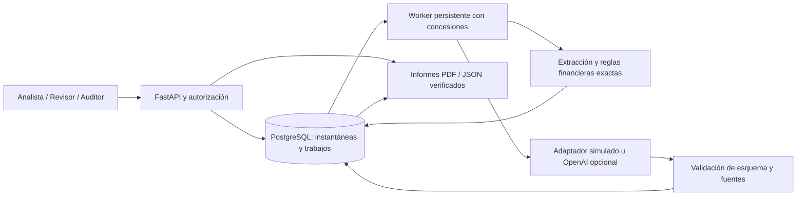
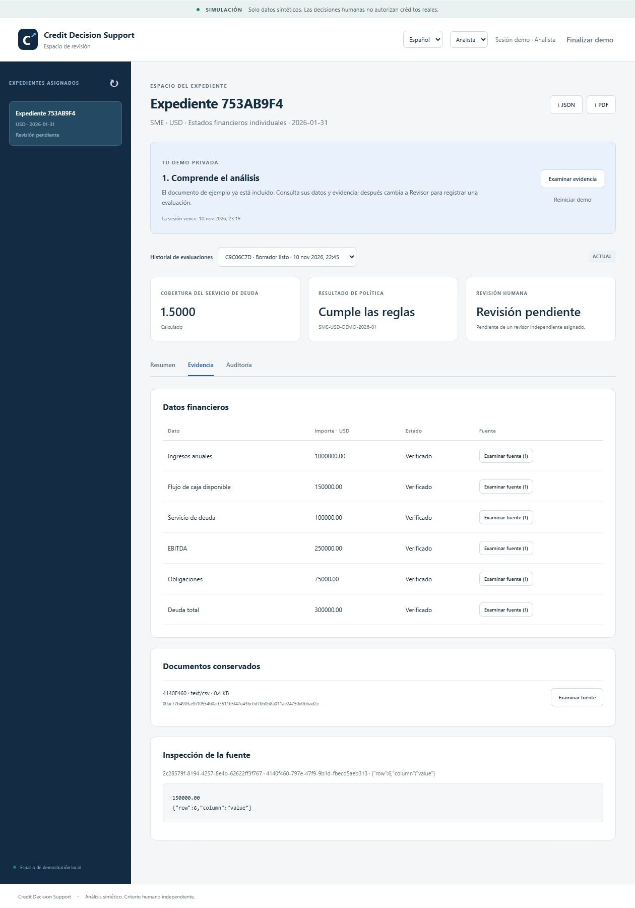
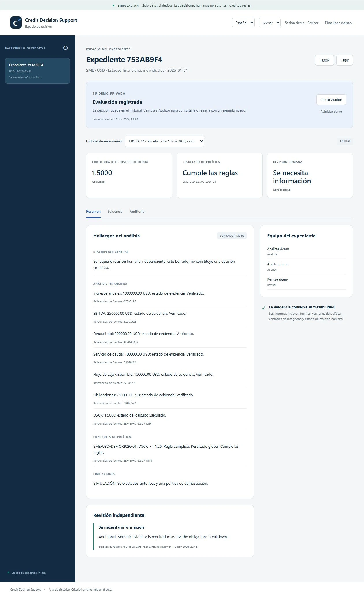
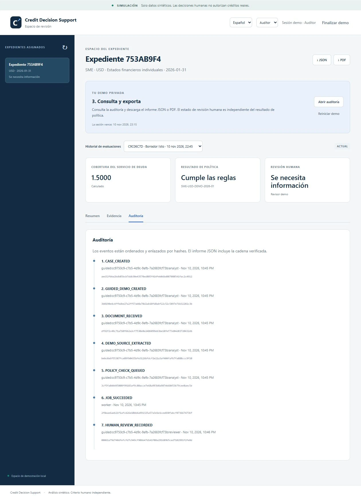

# Presentación del proyecto

[English](../presentation.md) | **Español**

Credit Decision Support es una demostración de análisis crediticio sintético que combina evidencia verificable, reglas financieras deterministas, flujos de modelo acotados y revisión humana separada. La pregunta central es: ¿puede rastrearse cada conclusión hasta sus entradas y revisarse sin confundir el resultado de política con una decisión crediticia?

## Introducción breve

La aplicación transforma estados anuales sintéticos de PyME en un espacio de revisión auditable. Ingiere PDF/CSV, conserva referencias exactas, calcula DSCR con aritmética decimal, selecciona una política versionada y prepara tarjetas de borrador respaldadas por evidencia. Un revisor asignado registra una decisión simulada con motivo. El auditor consulta el historial y exporta informes bilingües PDF/JSON con una instantánea verificable. La demo guiada utiliza un modelo simulado y no requiere cuenta ni clave API.

## Recorrido

[Ver en español](../media/walkthrough.es.mp4) · [Watch English](../media/walkthrough.en.mp4)

Los videos de 50 segundos, sin audio, utilizan capturas reales con desplazamientos editados, títulos y rótulos. Son una presentación visual editada, no una grabación de pantalla en tiempo real ni una medición de latencia. El inglés es la versión principal y el español la secundaria. El motivo del revisor simulado permanece intacto al cambiar de idioma.

| Tiempo | Escena | Punto que explicar |
|---|---|---|
| 0–5 s | Proyecto y alcance | Datos ficticios, apoyo mediante borradores y sin autorización de créditos reales |
| 5–12 s | Vista del analista | Flujo 150.000 / servicio de deuda 100.000 = DSCR 1.5000; política y revisión son estados separados |
| 12–20 s | Evidencia | El importe 150.000 apunta a la fila/columna exacta del CSV conservado |
| 20–29 s | Evaluación del revisor | Otro actor simulado solicita información y aporta un motivo |
| 29–38 s | Auditoría | La decisión aparece en la cadena de eventos; la exportación conserva fuentes y auditoría |
| 38–45 s | Arquitectura | API, worker persistente, herramientas deterministas, validación del modelo y PostgreSQL |
| 45–50 s | Evidencia y límites | 186 pruebas de Linux CI; 40/40 casos controlados; sin garantía de fiabilidad en producción |

Narración sugerida:

> Credit Decision Support demuestra análisis crediticio con evidencia y estados financieros ficticios. El analista consulta un DSCR de 1.5000, calculado a partir del flujo disponible y el servicio de deuda verificados. Cada importe conduce a su fuente. Cumplir la política de demostración no aprueba un crédito: un revisor separado registra una decisión y su motivo. El auditor puede rastrear esa acción y exportar un informe verificado. Un worker persistente ejecuta extracción, controles financieros y pasos de modelo acotados. La demo utiliza un modelo simulado; OpenAI es una integración opcional con controles separados. Las pruebas y mediciones sintéticas pequeñas respaldan la implementación; siguen pendientes tiempos con usuarios reales, costos de infraestructura y validación de un despliegue más amplio.

## Explicación de arquitectura



El LLM propone observaciones de fuentes y organiza tarjetas permitidas. No calcula el ratio autorizado, modifica la política ni aprueba expedientes. La validación de fuente/valor precede a la persistencia; los cálculos y resultados publicados provienen del código. El texto material se genera desde tarjetas verificadas, por lo que no es una evaluación de alucinaciones en narrativa libre. El adaptador opcional usa reservas duraderas de costo y no reintenta automáticamente una llamada pagada incierta.

Los trabajos persisten en PostgreSQL y usan tokens de concesión para bloquear a workers obsoletos. La autorización por expediente se comprueba en el servidor. Las decisiones requieren otro identificador de actor y un registro inmutable con motivo. En la demo una misma persona puede alternar entre los tres actores simulados; esto no demuestra independencia entre personas reales ni identidad de producción. Antes de exportar se verifican hashes, localizadores, cálculos, políticas, borrador y cadena de auditoría. Los permisos de base de datos restringen mutaciones; el propietario de la base sigue siendo un límite de confianza.

## Evidencia medida

| Evidencia | Observación | Interpretación |
|---|---|---|
| [Protocolo de carga](../../evaluations/reports/hardening-load.json) | 40/40 casos, 240/240 campos, 40/40 informes; concurrencias 1/2/4/8 | Cohorte simulada pequeña; intervalo Wilson del 95%: 91,24–100% |
| [Análisis de carga](hardening.md) | p95 agregado de 14,02 s; p95 con concurrencia 8 de 16,18 s | Una API y un worker locales; ocho es el máximo probado, no un límite de saturación |
| [Comparación con modelo real](ai-workflow.md) | Versión 2: 12/12 flujos completados; los roles especializados consumieron más llamadas/costo | Dos repeticiones sobre tres variantes; no demuestra superioridad de un flujo |
| Linux CI al integrar la fase 6 | 186 pruebas aprobadas, aplicación empaquetada y comprobaciones de flujos/carga aprobadas | Controles verificados dentro del alcance declarado |

La propuesta fallida anterior sigue documentada y fue rechazada antes de publicar el borrador. La evidencia no incluye datos crediticios reales, aumentos de productividad no medidos, cumplimiento legal ni garantías de servicio. Estudios humanos cronometrados, asignación de infraestructura, carga prolongada, restauración de copias, protección distribuida e investigación de penetración independiente siguen fuera del alcance demostrado. Consultar [aceptación](acceptance.md).

## Capturas

### Vista del analista


### Evidencia



### Revisión humana



### Auditoría y exportación



## Regenerar el video

Las dependencias Python provienen del entorno del proyecto; se requiere un ejecutable local FFmpeg con soporte H.264. El generador solo lee capturas versionadas, no accede al navegador/modelo ni descarga dependencias.

```sh
uv run python scripts/build_presentation.py --ffmpeg /ruta/a/ffmpeg --output-dir storage/presentation
```

La salida contiene MP4 en ambos idiomas, transcripción de rótulos, una portada y metadatos de generación. El video es material de presentación; los datos de rendimiento provienen del informe de evaluación.
