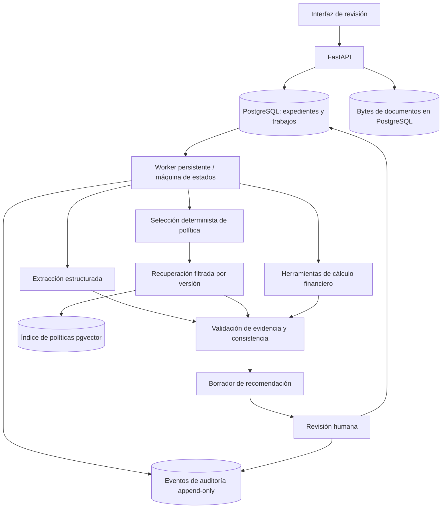

# Especificación del proyecto

[English](../specification.md) | **Español**

Estado: especificación inicial. Todas las cifras de rendimiento son metas de ingeniería, no resultados alcanzados. La [decisión de arquitectura](adr/001-mvp.md) y los [contratos de dominio](domain.md) definen el comportamiento detallado del MVP.

## Problema y usuarios

Los analistas de crédito revisan documentos financieros heterogéneos, concilian cifras, calculan ratios y justifican hallazgos frente a políticas crediticias. La preparación manual introduce riesgo de transcripción y dificulta el seguimiento de evidencia. El sistema prepara un análisis verificable con fuentes, cálculos, citas de políticas y limitaciones para una persona que toma la decisión.

El usuario principal es un analista de crédito PyME. Los revisores resuelven expedientes simulados; los auditores inspeccionan evidencia y eventos; los administradores gestionan la publicación de políticas. El alcance inicial es PyME/USD, periodos anuales completos y estados individuales, exclusivamente con datos sintéticos.

## Alcance funcional

1. Crear un expediente con UUID, segmento, moneda y fecha de corte.
2. Cargar documentos sintéticos PDF con texto/CSV UTF-8; aplicar límites de tamaño, formato, checksum y legibilidad.
3. Extraer ingresos, EBITDA, deuda, servicio de deuda, flujo de caja y obligaciones como hechos tipados con localizadores de evidencia. Representar explícitamente datos faltantes, ambiguos e inválidos.
4. Seleccionar exactamente una versión de política de forma determinista; recuperar fragmentos citados solo de esa versión y ejecutar sus reglas estructuradas.
5. Calcular ratios mediante código determinista con Decimal y fórmulas versionadas. Tratar explícitamente entradas faltantes, denominadores cero/negativos, unidades y periodos.
6. Señalar fuentes contradictorias y entradas fuera de alcance para revisión humana.
7. Generar un borrador de recomendación no vinculante con evidencia, referencias de cálculo, citas de políticas y limitaciones.
8. Registrar revisión humana, motivos, cambios y horas UTC. Exportar informes JSON/PDF con la marca SIMULATION en inglés o SIMULACIÓN en español.
9. Ofrecer una línea de tiempo de auditoría con autorización por expediente y reconstrucción de evaluaciones conservadas.

Quedan fuera del MVP la originación bancaria real, integración con burós, datos reales de clientes, decisiones automáticas, scoring personal opaco, certificación de cumplimiento legal, OCR, conversión de moneda, estados corporativos/consolidados y periodos parciales.

## Arquitectura

Los agentes extraen y sintetizan; las herramientas deterministas calculan y aplican reglas explícitas. La validación bloquea conclusiones sin respaldo. Un revisor humano resuelve el expediente simulado. Los contratos de dominio especifican persistencia, reintentos y controles de concurrencia.

## Tecnologías base

| Capa | Elección del MVP |
|---|---|
| API | Python 3.12, FastAPI, Pydantic v2 |
| Persistencia | PostgreSQL 16, SQLAlchemy, Alembic; recuperación full-text de referencia ([ADR-003](adr/003-policy-engine.md)) |
| Orquestación | Máquina de estados explícita en Python y trabajos persistidos en base de datos |
| Modelos | Adaptador independiente del proveedor, salidas estructuradas validadas y mock de CI sin conexión |
| Documentos | Almacenamiento transaccional en PostgreSQL; parsers de PDF con texto y CSV UTF-8 ([ADR-002](adr/002-ingestion.md)) |
| Interfaz | Interfaz de revisión React/TypeScript |
| Calidad y operaciones | Docker Compose, pytest, Ruff, mypy, GitHub Actions y detección de secretos |

Temporal, MCP, Kafka, Kubernetes, reranking, almacenamiento compatible con S3, aislamiento multi-tenant, OCR y segmentos adicionales son posibles ampliaciones, sujetas a una decisión de arquitectura y evidencia de necesidad.

## Hipótesis de evaluación

1. La extracción asistida reduce el tiempo de preparación sin disminuir la exactitud de campos frente a una referencia definida.
2. Los agentes especializados mejoran la cobertura de evidencia frente a un único flujo con el mismo modelo, presupuesto y herramientas.
3. Conservar entradas, salidas, versiones, reglas y revisiones permite reconstruir una evaluación concreta.

Un generador sintético con semilla produce formatos diversos, entradas incompletas, cifras ambiguas y casos límite de políticas. Las particiones train/dev/test se separan por expediente y familia de plantilla. El [protocolo de evaluación](acceptance.md) define referencias, repeticiones, denominadores, abstenciones e incertidumbre.

| Métrica | Meta inicial de diseño |
|---|---|
| Exactitud de extracción | Al menos 95 % en el corpus sintético controlado; revisar frente a la referencia |
| Cobertura de evidencia de afirmaciones materiales | Al menos 99 % de las afirmaciones materiales emitidas; abstención por separado |
| Afirmaciones materiales sin respaldo | Cero observadas en aceptación; publicar cantidades y tamaño de muestra |
| Intervención humana | Medir sin reducir revisión a costa de exactitud |
| Tiempo hasta borrador | Establecer referencia; aspiración inicial inferior a 15 minutos en casos declarados |
| Ejecución correcta | Al menos 99 % bajo un protocolo declarado; fallos inducidos por separado |
| Reconstrucción de auditoría | 100 % de evaluaciones de prueba conservadas, sin implicar cumplimiento legal |
| Coste por expediente | Tokens y asignación de infraestructura en USD con sensibilidad al tamaño |

Estas metas no demuestran rendimiento real ni garantizan niveles de servicio. Diez casos de extremo a extremo solo establecen cobertura del flujo. Las afirmaciones de ahorro de tiempo o cumplimiento requieren evidencia independiente apropiada.

## Seguridad y uso responsable

Se utilizan exclusivamente datos sintéticos. Se aplican permisos por expediente y separación entre preparación y revisión. El contenido documental y recuperado se trata como dato no confiable; las herramientas se restringen y los agentes no ejecutan comandos de shell. Se protegen comunicaciones y secretos, se redactan logs y se documenta la retención. Las posibles disparidades se evalúan en grupos simulados sin extrapolarlas a solicitantes reales. La revisión humana por sí sola no demuestra equidad ni cumplimiento normativo. Véase el [modelo de amenazas](threat-model.md).

## Criterios de finalización y decisiones abiertas

El MVP completo requiere arranque reproducible, migraciones, CI, evidencia verificada, reglas deterministas, revisión humana, reconstrucción de auditoría, al menos diez casos variados de extremo a extremo, informes de evaluación medidos y una demo breve. La [hoja de ruta](roadmap.md) define criterios intermedios.

La fase 4 utiliza OpenAI de forma opcional con una asignación local acumulada de US$2; los controles y límites están en el [flujo de IA](ai-workflow.md). Permanecen abiertas las licencias de documentos y ejemplos y el alcance de futuras ampliaciones de extracción o infraestructura. Las políticas sintéticas no representan las políticas de crédito de un banco. Las plantillas de origen y los ejemplos generados requieren procedencia y derechos de uso documentados.
