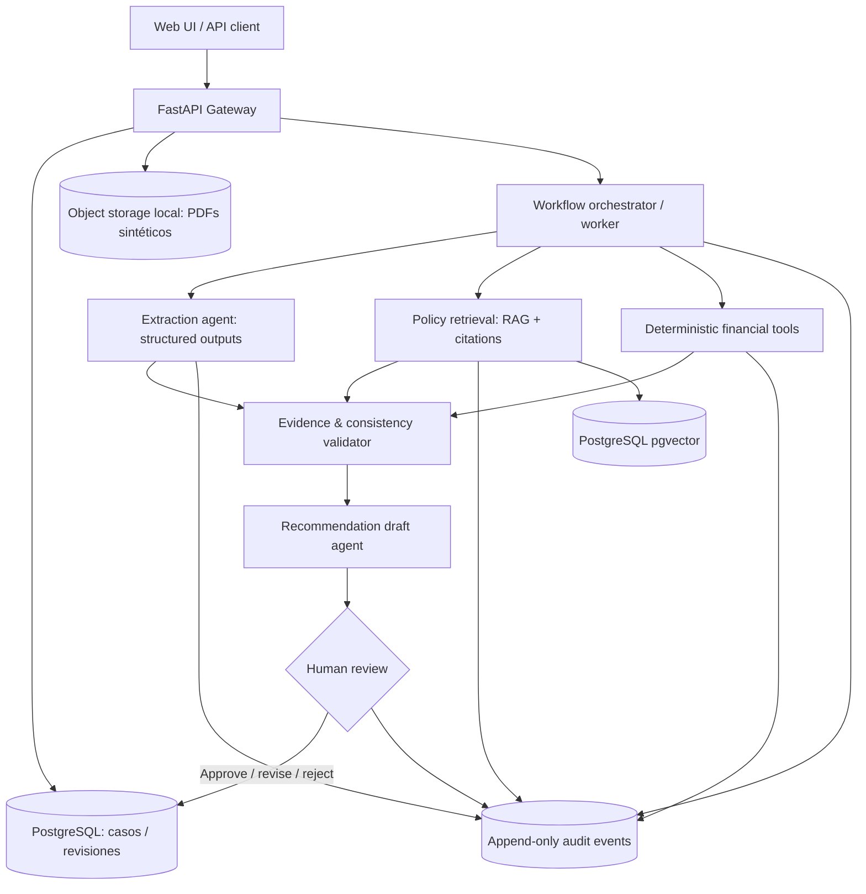

# Proyecto 01 — Credit Decision Support: Enterprise Agentic AI

> **Estado:** especificación de diseño; implementación pendiente.  
> **Versión:** 1.0 · 2026-11-07  
> **Tipo:** portafolio técnico / sistema demostrativo de IA aplicada a finanzas.  
> **Afirmaciones de rendimiento:** **ninguna cifra es un resultado alcanzado**. Las metas aquí definidas son hipótesis sujetas a pruebas.

## 1. Resumen ejecutivo

Construir una plataforma de **asistencia a evaluación crediticia** para solicitudes corporativas o de pequeñas empresas. Ingiere documentos ficticios o sintéticos, extrae datos con evidencia, valida completitud y consistencia, realiza cálculos financieros deterministas, recupera políticas de crédito versionadas y genera un informe de recomendación con citas y trazabilidad. La decisión **no** queda a cargo del modelo de lenguaje: un analista humano confirma, modifica o rechaza la recomendación; un motor de reglas aplica restricciones explícitas. El objetivo de ingeniería es demostrar agentes especializados, RAG evaluable, integración con herramientas, orquestación durable y controles de sistemas de IA en un dominio sensible.

**Propuesta de valor:** reducir el esfuerzo manual de preparación y revisión de expedientes *sin sacrificar evidencia, auditabilidad ni supervisión humana*.

### 1.1 Problema y usuarios

- **Problema:** expedientes heterogéneos (PDF, tablas, formularios y políticas), largos tiempos de revisión, errores de transcripción, dificultad para justificar evaluaciones y documentar excepciones.
- **Usuario primario:** analista de riesgo crediticio; **secundarios:** responsable de aprobaciones, auditor y administrador de políticas.
- **Job-to-be-done:** «Dado un expediente y la política aplicable, necesito un resumen verificable de datos, alertas, cálculos y fuentes para tomar una decisión informada».
- **Fuera del alcance del MVP:** originación bancaria real, conexión a burós, uso de datos personales de clientes, decisiones automáticas de crédito, scoring opaco de personas, afirmaciones de cumplimiento legal automático.

### 1.2 Hipótesis a validar

1. La extracción estructurada asistida por LLM es más rápida que la revisión manual sintética de referencia **sin degradar la exactitud**.
2. Un flujo de agentes con herramientas restringidas produce mejor cobertura de evidencias que un único prompt generalista.
3. Un historial inmutable de entradas, reglas, citas, resultados y aprobaciones permite reconstruir evaluaciones concretas.

## 2. Alcance funcional

### 2.1 Funciones MVP (obligatorias)

1. Crear expediente con identificador UUID, segmento (PyME/corporativo) y fecha de corte.
2. Subir documentos **sintéticos** PDF/CSV; comprobar tipo, tamaño, checksum e integridad.
3. Extraer campos (ingresos, EBITDA, deuda, servicio de deuda, flujo de caja, obligaciones) con **fuente, página y confianza**; marcar `missing` si no hay soporte.
4. Recuperar política relevante desde un repositorio **versionado**, con citas a fragmentos; el LLM nunca inventa una regla.
5. Ejecutar indicadores por código puro (p. ej. DSCR = flujo disponible para servicio de deuda / servicio de deuda; política define convenciones y casos de denominador cero).
6. Identificar inconsistencias documentales y solicitar revisión humana.
7. Generar **borrador no vinculante** de recomendación con evidencias, limitaciones y motivos; los agentes no emiten decisión final.
8. Registrar revisión humana, cambios, razones y timestamps; exportar reporte JSON/PDF marcado «SIMULACIÓN».
9. Consultar una línea de tiempo auditable de las acciones.

### 2.2 Posterior al MVP (optativo)

- Temporal para procesos persistentes y reintentos, pasos de validación humana y compensaciones.
- MCP para exposición de **herramientas permitidas** con contratos explícitos; no usar MCP si una llamada directa proporciona menor complejidad en MVP.
- Kafka para ingestión asíncrona y eventos de estado cuando exista una prueba de carga que lo justifique.
- Comparación de versiones de políticas e impacto de cambios; extracción multimodal más avanzada; multi-tenant aislado.
- Despliegue Kubernetes cuando se hayan documentado necesidades de escalado; primero Docker Compose.

## 3. Arquitectura propuesta



**Principio de diseño:** los agentes proponen o sintetizan; herramientas deterministas calculan; el validador rechaza conclusiones no respaldadas; la persona decide.

### 3.1 Servicios, responsabilidades y límites

| Componente | Responsabilidad | Fallos esperables / mitigación |
|---|---|---|
| API | Autenticación demo, expedientes, carga, consulta, revisión | Validación Pydantic, límites de entrada, RBAC |
| Ingesta | Parsear PDF/CSV, normalizar tablas, checksum | OCR solo si es imprescindible; rechazar documento no legible |
| Extracción | Devolver JSON tipado y anclajes a evidencia | `unknown` + revisión; no asumir cifras |
| Recuperación | Buscar políticas por versión/fecha, citar fuentes | Umbral de relevancia, abstención sin respaldo |
| Cálculos | Ratios y comprobaciones usando Python | Tests de unidades, precisión decimal |
| Orquestación | Estados, reintentos, idempotencia, control humano | Backoff, timeouts, reanudación |
| Auditoría | Registrar actor, entrada referenciada, resultado, versión | Hash encadenado opcional, almacenamiento append-only |
| Observabilidad | Métricas, logs y trazas sin datos sensibles | Correlation ID, redacción de secretos |

### 3.2 Flujo de estados

`CREATED → DOCUMENTS_RECEIVED → EXTRACTING → VALIDATING → POLICY_CHECK → DRAFT_READY → PENDING_HUMAN_REVIEW → {APPROVED_BY_HUMAN | REJECTED_BY_HUMAN | NEEDS_MORE_INFO}`.  
Los errores conducen a `FAILED_RETRYABLE` o `FAILED_TERMINAL`, con causa registrada. «Aprobado» significa **aprobación ficticia del flujo de prueba**, nunca una autorización crediticia legal.

### 3.3 Contratos de datos (ejemplos)

```json
{
  "case_id": "uuid",
  "policy_version": "SME-POLICY-2026-01",
  "documents": [{"document_id":"uuid","sha256":"...","kind":"financial_statement"}],
  "facts": [{
    "key":"annual_revenue", "value":"2500000.00", "currency":"USD",
    "period":"2025", "source_document_id":"uuid", "page":3,
    "source_excerpt":"...", "confidence":0.94, "status":"extracted"
  }],
  "exceptions": [{"code":"MISSING_DEBT_SCHEDULE","severity":"requires_review"}],
  "recommendation": {"status":"DRAFT_ONLY", "summary":"...", "evidence_ids":["fact-id"]}
}
```

- Usar `Decimal` para cantidades financieras; políticas versionadas y fechas en UTC; `idempotency_key` para creación de trabajos.
- `confidence` refleja la salida del extractor y **no es una probabilidad calibrada** hasta realizar calibración.
- Las citas referencian documento/página y fragmento, con detector de inconsistencia entre texto citado y valor extraído.

### 3.4 APIs principales

| Método | Ruta | Resultado / control |
|---|---|---|
| `POST` | `/v1/cases` | expediente + `case_id` |
| `POST` | `/v1/cases/{id}/documents` | comprobante y procesamiento asíncrono |
| `POST` | `/v1/cases/{id}/evaluate` | `job_id`; idempotente |
| `GET` | `/v1/cases/{id}` | estado y enlaces a evidencias |
| `GET` | `/v1/cases/{id}/report` | informe solo si fase válida |
| `POST` | `/v1/cases/{id}/review` | decisión humana + motivación obligatoria |
| `GET` | `/v1/cases/{id}/audit-events` | historial paginado, acceso restringido |
| `GET` | `/healthz`, `/readyz` | salud y dependencias |

## 4. Tecnologías: decisión por etapas

| Capa | MVP elegido | Extensión y razón |
|---|---|---|
| Backend | Python 3.12+, FastAPI, Pydantic v2 | Spring Boot solo para demostrar integración multi-lenguaje si aporta valor |
| Estado | PostgreSQL + SQLAlchemy + Alembic | pgvector para índice de políticas; evitar DB vectorial separada al inicio |
| Agentes | LangGraph o Python explícito con máquinas de estado | Elegir uno; instrumentar cada paso |
| LLM | proveedor configurable mediante interfaz; mock local para CI | Salidas JSON con validación; no depender de un proveedor único |
| Retrieval | pgvector, fragmentación y metadatos por política | reranking únicamente tras benchmark |
| Flujo | worker sencillo + jobs en base de datos | Temporal cuando se justifiquen ejecuciones durables multi-etapa |
| Archivos | almacenamiento local privado de desarrollo | S3 compatible para despliegue |
| DevOps | Docker Compose, pytest, Ruff, mypy, GitHub Actions | Kubernetes después de pruebas de rendimiento |
| Frontend | React/TypeScript ligero o Streamlit | interfaz de comparación, evidencia y revisión |

**No** instalar Kafka + Redis + Temporal + Kubernetes desde el día uno: se introducirán únicamente al demostrar qué problema resuelven. Si se desea practicar todo el stack, construir una rama `advanced-architecture` después de estabilizar MVP.

## 5. Evaluación y métricas

### 5.1 Dataset y protocolo

- Crear expedientes **sintéticos** con generador reproducible (`seed` versionado); diversidad de formatos, políticas, cifras ambiguas y casos incompletos.
- Mantener conjunto `train/dev/test` a nivel **expediente**, no por fragmentos de un mismo archivo; test oculto al ajustar prompts.
- Baseline A: captura manual simulada con registro de tiempo y calidad (si se dispone de evaluadores); Baseline B: extracción simple sin RAG/agentes.
- Registrar versiones de modelo, prompts, documentos y política; ejecutar varias repeticiones para variabilidad.

### 5.2 KPIs (metas de diseño, no resultados)

| Métrica | Definición | Objetivo inicial de ingeniería |
|---|---|---|
| Exactitud de extracción | campos correctos / campos evaluables, por tipo | ≥95 % en dataset sintético controlado; recalibrar con baseline |
| Cobertura de evidencia | afirmaciones materiales con referencia verificable / total | ≥99 % de afirmaciones materiales o abstención |
| Tasa de alucinación | afirmaciones materiales no sustentadas / total | objetivo 0 en test de aceptación; reportar observadas |
| Revisión humana | casos que requieren intervención / total | medir, **no** minimizar a costa de errores |
| Tiempo hasta borrador | mediana, p95, desde carga completa hasta `DRAFT_READY` | establecer baseline primero; aspiración <15 min en casos de prueba |
| Fiabilidad | ejecuciones correctas / ejecuciones iniciadas | ≥99 % en conjunto de pruebas, excluyendo fallos intencionales |
| Reconstrucción de auditoría | evaluaciones reconstruibles con entradas/versiones / total | 100 % en batería de pruebas, no equivalencia con cumplimiento legal |
| Coste por expediente | tokens + infraestructura por ejecución | registrar USD/caso y sensibilidad al tamaño del expediente |

**Advertencia:** ningún resultado debe publicarse como «reduje evaluación de días a minutos» sin estudio comparativo real; «cumplimiento 100 %» no es una afirmación válida.

## 6. Seguridad, ética y control

- Solo datos ficticios/sintéticos; nada de PII real ni credenciales embebidas.
- Separación de roles `analyst`, `reviewer`, `auditor`, `admin`; autorización por expediente.
- Defensa contra prompt injection: contenido recuperado es **dato no confiable**, no instrucción; herramientas allowlist, no ejecución de comandos a través del agente.
- Bloqueo de decisiones finales automáticas; decisiones adversas requieren motivación y revisión humana.
- Evaluación de sesgos: evitar atributos protegidos como proxies; validar posibles disparidades en conjuntos simulados, sin extrapolar a personas reales.
- Cifrado en tránsito, secretos por variables de entorno, logs redactados y política de retención.
- Archivo de políticas y evaluaciones versionado; no afirmar que se satisface normativa bancaria, GDPR, ECOA u otra sin revisión jurídica específica.

## 7. Pruebas y aceptación

### 7.1 Pruebas

- **Unitarias:** ratios, conversiones, políticas, reglas, parser y estados.
- **Contratos:** respuestas de LLM JSON válidas, esquemas de API y herramientas MCP (si existen).
- **Integración:** upload → extracción → validación → recomendación → aprobación humana; restart del worker.
- **Adversariales:** PDF con instrucciones maliciosas, fuentes contradictorias, ratio con división por cero, documentos vacíos, respuestas del LLM sin evidencia.
- **Resiliencia:** timeout del modelo, doble petición idempotente, caída de DB, reintentos sin duplicar auditorías.
- **End-to-end:** 10 expedientes sintéticos variados con trazas completas.

### 7.2 Definition of Done (MVP)

- `docker compose up` inicia dependencias y backend con datos demo.
- CI ejecuta tests, lint, type-check y chequeo de secretos.
- Al menos 10 expedientes de prueba; informe con métricas **medidas** y scripts para reproducirlas.
- Toda afirmación material cita un documento o se marca como no verificada.
- Un auditor puede rastrear entrada, transformación, salida y revisión humana.
- Demo de 3–5 minutos más README con diagrama, limitaciones y decisiones.

## 8. Plan de construcción para Codex

| Fase | Entregable | Criterio para avanzar |
|---|---|---|
| 0. Especificación | ADR-001, esquemas de datos, `openapi.yaml`, dataset sintético | contratos revisados, sin backend aún |
| 1. Base | monorepo, FastAPI, DB/migraciones, Compose, CI | tests y salud estables |
| 2. Ingesta | parser PDF/CSV, repositorio de documentos, extracción mock | trazabilidad de campos por página |
| 3. Políticas y reglas | retrieval versionado, ratios deterministas | baseline evaluado |
| 4. IA | extracción y redacción con agentes y validadores | eval reproducible y fallos controlados |
| 5. Flujo humano | aprobación/rechazo/revisión, auditoría, UI | end-to-end íntegro |
| 6. Hardening | seguridad, observabilidad, pruebas de carga | informe de límites medidos |
| 7. Avanzado | Temporal, MCP, Kafka, Kubernetes individualmente | ADR y benchmark por cada incorporación |

### 8.1 Estructura de repositorio recomendada

```text
credit-decision-support/
  README.md  LICENSE  .env.example  compose.yaml
  docs/architecture.md  docs/adr/  docs/threat-model.md
  apps/api/  apps/ui/
  packages/domain/  packages/ingestion/  packages/agents/
  packages/policy_engine/  packages/audit/
  data/synthetic/  evaluations/datasets/  evaluations/reports/
  tests/unit/  tests/integration/  tests/e2e/
  scripts/generate_synthetic_cases.py  .github/workflows/ci.yml
```

### 8.2 Prompt inicial para Codex

> Lee **completamente** `01_Credit_Decision_Support_Agentic_AI.md` antes de escribir código. No supongas que el sistema ya existe. Comienza solo por la **fase 0**: propón ADR-001, modelo de dominio, esquema SQL, OpenAPI inicial, amenazas y plan de pruebas. No implementes Kubernetes, Kafka, MCP ni Temporal en el MVP. Separa cifras objetivo de resultados medidos. Usa expedientes sintéticos y mantén siempre revisión humana para la decisión final. Entrega cambios pequeños, ejecuta pruebas y explica riesgos/decisiones. Detente tras la fase 0 con una lista de criterios de aceptación.

### 8.3 Prompts por fase (plantillas)

- **Fase 1:** «Implementa únicamente fase 1 respetando contratos aprobados; añade migraciones, Compose, tests y README de ejecución; muestra comandos y resultados».
- **Fase 2:** «Implementa ingesta y generador sintético. Prueba PDFs rotos, páginas sin datos y cifras ambiguas. No invoques un LLM si no hace falta».
- **Fase 4:** «Incorpora adaptador de modelos intercambiable, proveedor mock de CI, salida validada, trazas y evaluación reproducible. Rechaza afirmaciones sin citas».
- **Revisión:** «Audita seguridad, idempotencia, filtración de PII, prompt injection, métricas y reproducibilidad. No afirmes cumplimiento regulatorio».

## 9. Material público para LinkedIn y GitHub (tras implementar)

- Demo breve: flujo de expediente sintético hasta informe verificable y revisión humana.
- Capturas: políticas citadas, trazabilidad, UI de validación, dashboard de evaluación.
- Artículo técnico sugerido: **“Building an Auditable Agentic AI Workflow for Credit Decision Support”**.
- Descripción honesta: «Personal portfolio project built with synthetic data; human-reviewed decision support; evaluation results and limitations documented».
- No usar la frase «I built… reduced days to minutes» hasta medir exactamente ese resultado en un experimento válido.

## 10. Riesgos y decisiones abiertas

1. Elección de LLM y presupuesto de tokens (adaptador desacoplado).
2. Calidad de extracción PDF, OCR y tablas (definir corpus antes de prometer exactitud).
3. Políticas sintéticas que no representen reglas bancarias reales.
4. Diseño de evidencia y redacción de hallazgos potencialmente sensibles.
5. Complejidad de Temporal/MCP/Kafka vs. valor demostrable.
6. Contrato de licencia para los documentos de ejemplo y políticas simuladas.

**Resultado final esperado:** una solución demostrativa reproducible donde la principal virtud no sea la cantidad de frameworks, sino la **calidad de la ingeniería, la evaluación y la explicabilidad verificable**.
