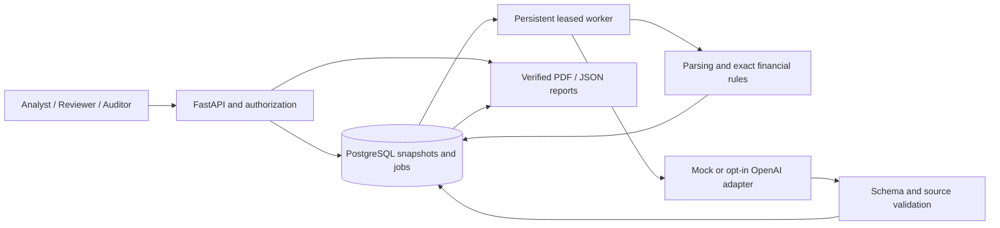
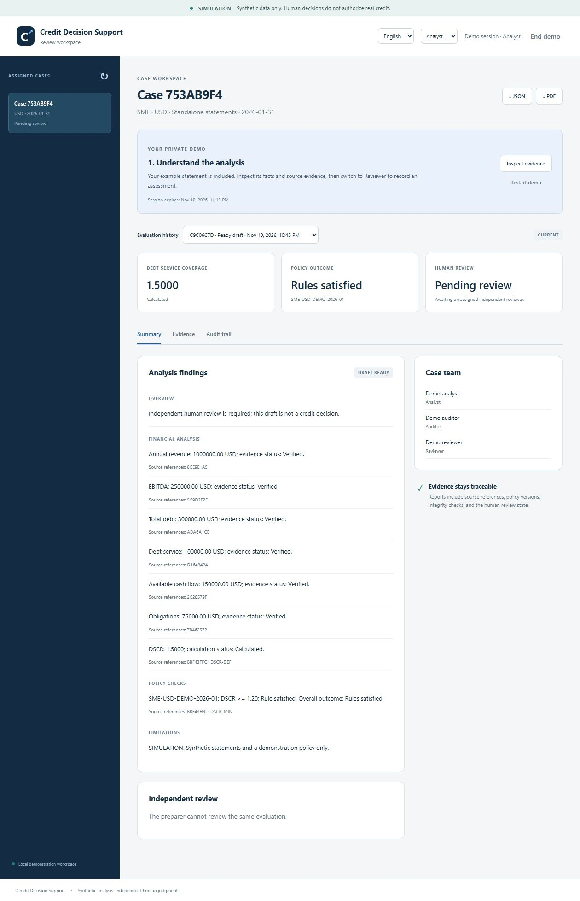
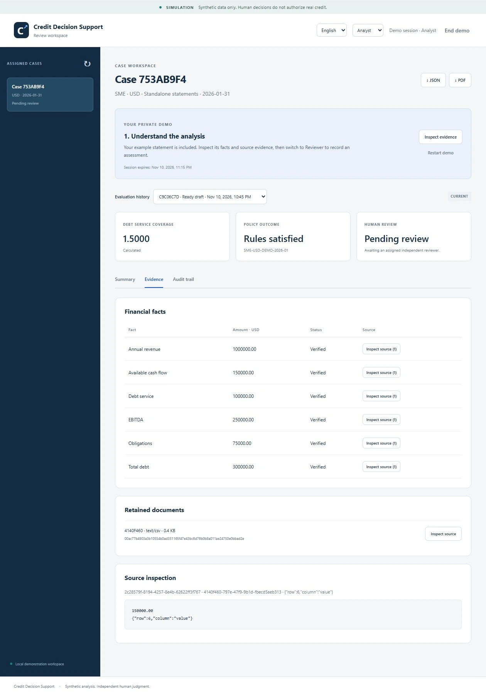
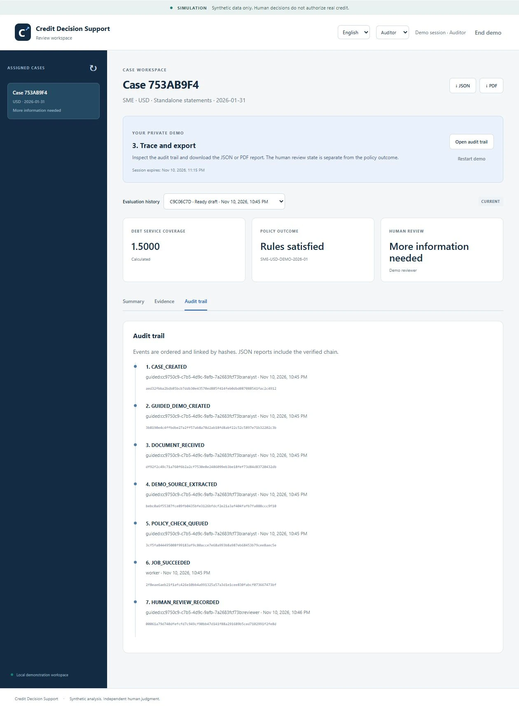

# Project presentation

**English** | [Español](es/presentation.md)

Credit Decision Support is a synthetic credit-analysis demonstration that combines verified evidence, deterministic financial rules, bounded model workflows, and a separate human review. The central question is: can every displayed conclusion be traced to its inputs and reviewed without confusing a policy result with a credit decision?

## Short introduction

The application turns synthetic annual SME statements into an auditable review workspace. It ingests PDF/CSV files, retains exact source references, calculates DSCR using decimal arithmetic, selects a versioned policy, and prepares evidence-backed draft cards. An assigned reviewer records a reasoned simulated decision. Auditors inspect the history and export bilingual PDF/JSON reports with a verifiable snapshot. The guided demo uses a simulated model and requires no account or API key.

## Walkthrough

[Watch English](media/walkthrough.en.mp4) · [Ver en español](media/walkthrough.es.mp4)

The 50-second silent videos use actual application screenshots with edited pans, titles, and captions. They are an edited visual presentation, not a real-time screen recording or a latency measurement. English is the primary version; Spanish is the secondary version. The simulated reviewer reason remains verbatim when switching language.

| Time | Scene | Point to explain |
|---|---|---|
| 0–5 s | Project and scope | Synthetic data; draft support; no real credit authorization |
| 5–12 s | Analyst overview | Cash flow 150,000 / debt service 100,000 = DSCR 1.5000; policy result and review state are separate |
| 12–20 s | Source evidence | The 150,000 figure points to the exact retained CSV row/column |
| 20–29 s | Reviewer assessment | A different simulated actor requests more information and supplies a reason |
| 29–38 s | Auditor history | The decision appears in the event chain; PDF/JSON export retains source and audit references |
| 38–45 s | Architecture | API, durable worker, deterministic tools, model validation, and PostgreSQL |
| 45–50 s | Evidence and limits | 186 Linux CI tests; 40/40 controlled load cases; no production reliability claim |

Suggested narration:

> Credit Decision Support demonstrates evidence-based credit analysis using fictitious statements. The analyst sees a DSCR of 1.5000, calculated from verified cash flow and debt service. Each amount links back to its source. Meeting the demonstration policy does not approve credit: a separate reviewer records a decision and its reason. The auditor can trace that action and export a verified report. A persistent worker runs extraction, financial checks, and bounded model steps. The guided demonstration uses a simulated model; OpenAI is an optional, separately controlled integration. Tests and small synthetic load measurements support the implementation, while real-user timing, infrastructure costs, and broader deployment validation remain open.

## Architecture explanation



The LLM proposes source observations and organizes allowlisted draft cards. It does not calculate the authoritative ratio, alter the policy, or approve a case. Source/value validation precedes persistence; published financial calculations and policy outcomes come from code. Material wording is rendered from verified cards, so this is not an open-ended narrative hallucination benchmark. The optional live adapter uses durable cost reservations and does not automatically retry an uncertain paid call.

Jobs persist in PostgreSQL and use lease tokens to fence stale workers. Case membership is checked on the server. Human decisions require an independent actor ID and an immutable reasoned review record. In the guided demonstration, one visitor can switch among all three simulated actors; this is not proof of independent real people or production identity verification. Exports verify source hashes, locators, financial results, policy versions, draft hashes, and the audit chain before rendering. Runtime database privileges restrict mutation; database-owner control remains a trust boundary.

## Measured evidence

| Evidence | Observation | Interpretation |
|---|---|---|
| [Hardening protocol](../evaluations/reports/hardening-load.json) | 40/40 cases, 240/240 expected fields, 40/40 reports; concurrency 1/2/4/8 | Small controlled mock cohort; 95% Wilson success interval 91.24–100% |
| [Hardening analysis](hardening.md) | Aggregate upload-to-draft p95 14.02 s; concurrency-8 p95 16.18 s | One local API/worker; eight is the highest tested concurrency, not a saturation limit |
| [Live model comparison](ai-workflow.md) | Version 2: 12/12 bounded live workflows completed; specialized roles used more calls/cost than the generalist | Two repetitions on three synthetic variants; no evidence of workflow superiority |
| Linux CI at Phase 6 integration | 186 tests passed; packaged API/worker and smoke/load checks passed | Implemented controls verified within the declared test scope |

The earlier failed live proposal remains documented and was rejected by validation before draft publication. No real credit data, unmeasured productivity gain, legal-compliance claim, or production service guarantee is part of the evidence. Timed human studies, infrastructure cost allocation, sustained load, backup restoration, distributed abuse protection, and an independent penetration test remain outside the demonstrated scope. See [acceptance](acceptance.md) for the complete target interpretation.

## Screenshots

### Analyst overview



### Source evidence



### Human review


### Audit and export



## Rebuild the video

Python dependencies are supplied by the project environment; a local FFmpeg executable with H.264 support is required. The generator reads the versioned screenshots only, makes no browser or model requests, and does not download dependencies.

```sh
uv run python scripts/build_presentation.py --ffmpeg /path/to/ffmpeg --output-dir storage/presentation
```

The output contains English/Spanish MP4 videos, a caption transcript, a poster, and render metadata. Video artifacts are presentation media; numeric performance evidence remains in the evaluation report.
