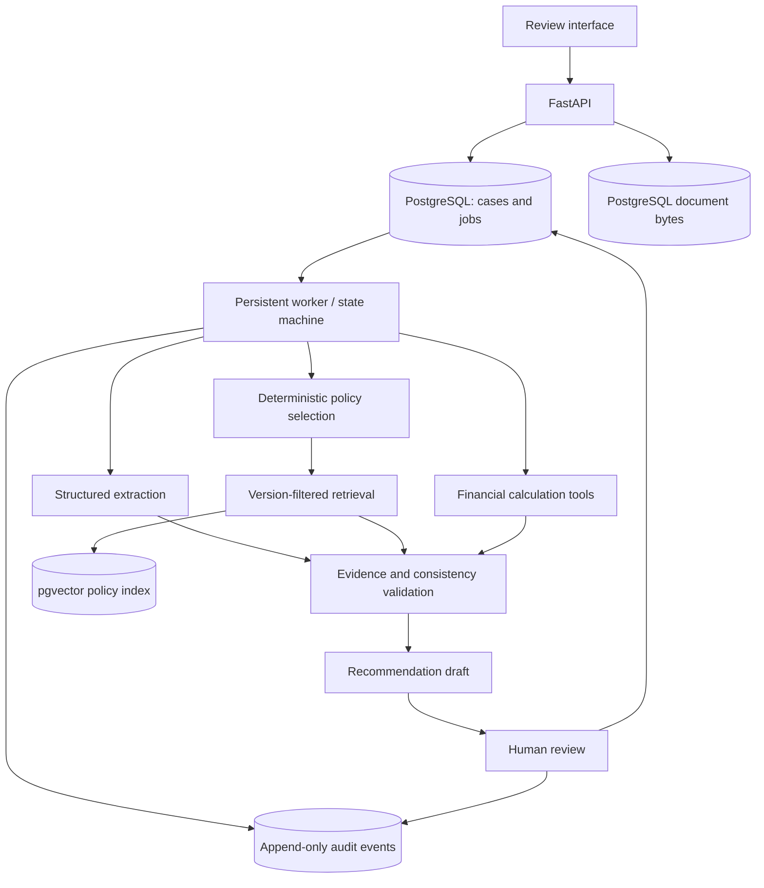

# Project specification

**English** | [Español](es/specification.md)

Status: design baseline. All performance figures are engineering targets, not achieved results. The [architecture decision](adr/001-mvp.md) and [domain contracts](domain.md) define the detailed MVP behavior.

## Problem and users

Credit analysts review heterogeneous financial documents, reconcile amounts, calculate ratios, and justify findings against credit policy. Manual preparation creates transcription risk and makes evidence tracking expensive. The system prepares a verifiable analysis with sources, calculations, policy citations, and limitations for a human decision maker.

The primary user is an SME credit analyst. Reviewers resolve simulated cases; auditors inspect evidence and events; administrators manage policy publication. The initial scope is SME/USD, complete annual periods, and standalone statements, using synthetic inputs only.

## Functional scope

1. Create a case with a UUID, segment, currency, and cutoff date.
2. Upload synthetic text-based PDF/UTF-8 CSV documents; enforce size, format, checksum, and readability limits.
3. Extract revenue, EBITDA, debt, debt service, cash flow, and obligations into typed facts with evidence locators. Represent missing, ambiguous, and invalid data explicitly.
4. Select exactly one policy version deterministically; retrieve cited fragments only from that version and execute its structured rules.
5. Compute financial ratios in deterministic code using Decimal and versioned formulas. Handle missing inputs, zero/negative denominators, units, and periods explicitly.
6. Flag inconsistent sources and unsupported inputs for human review.
7. Generate a nonbinding recommendation draft with evidence, calculation references, policy citations, and limitations.
8. Record human review, reasons, changes, and UTC timestamps. Export JSON/PDF reports labeled SIMULATION in English or SIMULACIÓN in Spanish.
9. Provide a case-authorized audit timeline and reconstructible retained evaluations.

Real bank origination, credit-bureau integration, real customer data, automatic credit decisions, opaque personal scoring, legal-compliance certification, OCR, currency conversion, corporate/consolidated statements, and partial periods are outside the MVP.

## Architecture

Agents extract and synthesize; deterministic tools calculate and apply explicit rules. Validation blocks unsupported conclusions. A human reviewer resolves the simulated case. Persistence, retry behavior, and concurrency controls are specified in the domain contracts.

## Technology baseline

| Layer | MVP choice |
|---|---|
| API | Python 3.12, FastAPI, Pydantic v2 |
| Persistence | PostgreSQL 16, SQLAlchemy, Alembic; pgvector for policy retrieval |
| Orchestration | Explicit Python state machine and database-backed jobs |
| Models | Provider-independent adapter, validated structured outputs, offline CI mock |
| Documents | Transactional PostgreSQL document storage; text-based PDF and UTF-8 CSV parsers ([ADR-002](adr/002-ingestion.md)) |
| Interface | React/TypeScript review interface |
| Quality and operations | Docker Compose, pytest, Ruff, mypy, GitHub Actions, secret scanning |

Temporal, MCP, Kafka, Kubernetes, reranking, S3-compatible storage, multi-tenancy, OCR, and additional segments are potential extensions, each subject to an architecture decision and evidence of need.

## Evaluation hypotheses

1. Assisted extraction reduces preparation time without reducing field accuracy against a defined reference.
2. Specialized agents improve evidence coverage relative to a single workflow with the same model, budget, and tools.
3. Retained inputs, outputs, versions, rules, and reviews support reconstruction of a specific evaluation.

A seeded synthetic generator supplies diverse formats, incomplete inputs, ambiguous figures, and policy boundaries. Train/dev/test splits are isolated by case and template family. The [evaluation protocol](acceptance.md) defines baselines, repetitions, denominators, abstentions, and uncertainty reporting.

| Metric | Initial design target |
|---|---|
| Field extraction accuracy | At least 95% on the controlled synthetic corpus; reassess against baseline |
| Material-claim evidence coverage | At least 99% of emitted material claims; report abstention separately |
| Unsupported material claims | Zero observed in acceptance tests; publish counts and sample size |
| Human intervention | Measure without reducing review at the expense of correctness |
| Time to draft | Establish baseline first; initial aspiration below 15 minutes on declared test cases |
| Successful execution | At least 99% within a declared test protocol; induced failures reported separately |
| Audit reconstruction | 100% of retained test evaluations, with no legal-compliance implication |
| Cost per case | Report model tokens and infrastructure allocation in USD with size sensitivity |

These targets do not establish real-world performance or a service-level guarantee. Ten end-to-end cases establish workflow coverage only. Time-saving and compliance claims require appropriate independent evidence.

## Security and responsible use

Use synthetic data exclusively. Enforce case-level permissions and separate analyst/reviewer duties. Treat document and retrieved text as untrusted data; restrict tools and prohibit agent shell execution. Protect transport and secrets, redact logs, and document retention. Evaluate potential disparities within simulated groups without extrapolating to real applicants. Human review does not by itself establish fairness or regulatory compliance. See the [threat model](threat-model.md).

## Completion criteria and open decisions

The complete MVP requires reproducible startup, migrations, CI, verified evidence, deterministic rules, human review, audit reconstruction, at least ten varied end-to-end cases, measured evaluation reports, and a brief demo. The [roadmap](roadmap.md) defines intermediate gates.

Open decisions include the live-model provider and token budget, fixture/document licensing, and the scope of later extraction or infrastructure extensions. Synthetic policies do not represent a bank's actual lending policy. Source templates and generated fixtures require documented provenance and usage rights.
